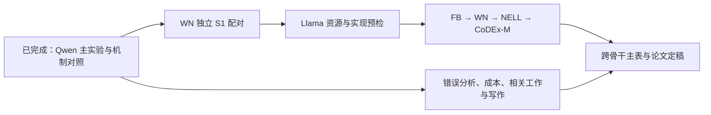

# GRIP-CU 冲刺 CCF B 计划

> 修订日期：2026-11-16（北京时间）。本版以已核实的实验记录为依据，替代旧版的当前排期。核心路线为：Qwen 证据收尾 → WN 独立 S1 检查 → Llama 跨骨干验证 → 论文与复现材料定稿。本文更新研究计划；新增训练尚未启动。

## 0. 当前阶段与下一步

项目已完成四数据集的 Qwen 首轮主实验和主要机制对照。seed2026 的 Soft-Mix 成绩均高于论文 Qwen 参考值；相对本地同条件 B1 的改进幅度、统计证据和生成错误代价存在数据集差异。当前需要补齐的是独立 S1 检查、跨骨干证据和完整成本记录。

| 工作 | 截至本次修订的状态 | 后续安排 |
| --- | --- | --- |
| 四数据集 Qwen 主实验 | 已完成；主配置为验证集选定的 Soft-Mix 1.0 | 冻结现有配置，保留全部已完成结果 |
| 逐题分析、NELL/FB Top-9 Hard | 已完成 | 纳入机制分析与适用边界 |
| WN 固定平均权重、NELL/FB 权重打乱 | 已完成 | 按题加权保留为消融，不作为已证实的核心优势 |
| FB 的 S2 时间预算匹配 B1 | 已完成，验证选定断点的测试为 89.61% | 补入成本与对照表，明确时间预算口径 |
| WN 独立 S1 的 B1 / Soft-Mix 配对 | 尚未启动 | 下一项 Qwen GPU 工作，只做一组独立起点检查 |
| Llama 四数据集 B1 / Soft-Mix | 尚未启动；活动模型缓存中未发现所需 Llama 权重 | 完成模型、代码与容量预检后按 FB → WN → NELL → CoDEx-M 执行 |
| 原 3/5-seed 四分支队列 | 已于 11 月 10 日停止 | 本版不恢复；已完成的其他 seed 完整保留 |
| 论文与复现材料 | 已有结果记录和方法草稿 | 与 GPU 阶段并行整理，最终数值由完成记录填入 |

本次核对时未发现活动 tmux 训练会话，GPU 处于空闲状态。运行状态是当时的快照，启动新任务前重新检查。

## 1. 论文主线：问题、机制与证据

### 1.1 核心研究问题

**在将图知识写入大语言模型参数的关系预测任务中，显式优化正确关系与候选负关系之间的相对得分，能否提高模型区分易混淆关系的能力？这种收益受负例构造、生成行为、训练起点和模型骨干怎样的影响？**

现有生成训练通过 token 级交叉熵学习正确答案，但没有显式以完整候选关系的相对得分构造本项目使用的对比目标。Soft-Mix 在答案生成损失之外加入候选关系对比损失，以覆盖型负例和教师混淆引导负例共同提供训练信号。

论文的论证顺序为：

1. **发现问题。** 用 B1 的候选内错误和关系混淆展示关系区分的不足，给出典型误判及其频次。
2. **提出机制。** 解释生成损失与候选对比损失如何共同优化；说明负例覆盖、难度和损失强度各自的作用。
3. **验证有效性。** 以同骨干、同 S1、同训练数据的 B1 为主比较，四数据集外部论文数值作为参照。
4. **解释适用范围。** 同时呈现 Top-9 的数据集差异、候选外错误和权重消融的负结果。
5. **检验可迁移性。** 在原 GRIP 使用的 Llama 骨干上独立训练同一方法，检查相对该骨干 B1 的收益是否保留。
6. **交代代价。** 分别报告 S2、教师训练/打分和全流程成本，给出实践上的准确率与成本取舍。

### 1.2 主张与证据对应关系

| 拟回答的问题 | 现有证据 | 尚需补齐 / 结论边界 |
| --- | --- | --- |
| 完整候选对比方案是否改善关系预测？ | 四数据集 Soft-Mix 相对同三轮 B1 均有正向差值 | NELL 增益较小；单 seed 不能证明跨训练随机性的稳定性 |
| 混合负例是否普遍优于纯困难负例？ | NELL 上 Soft-Mix 更好，FB 上 Top-9 更好 | 结论应体现数据集差异；暂停 Random-K 后，无法独立确认每个采样成分的必要性 |
| 按题分配对比权重是否有效？ | WN 常数权重优于原校准；NELL/FB 打乱未呈现一致劣化 | 当前结果不支持将 Calibrated 写成已经成立的核心创新 |
| 收益是否只是多用 S2 训练时间？ | FB 时间预算匹配 B1 为 89.61%，Soft-Mix 为 90.36% | 仅覆盖这一数据集和该时间分配协议；未匹配全流程计算成本 |
| WN 大幅增益是否依赖某个 S1 起点？ | 数据/评测核验完成；已有固定 S1 的 S2 复验 | 增加一组独立 S1 配对；两组起点仍不足以估计普遍稳定性 |
| 方法是否能迁移到另一模型家族？ | 当前只有 Qwen 证据 | 完成 Llama 四数据集的同骨干配对实验后判断 |

标题和摘要暂围绕“参数化图知识的候选关系对比训练”组织。当前评测主要支持关系预测能力与错误结构的变化；关于内部知识调用机制、多跳推理、普遍减少幻觉等更强解释，需要各自独立的证据。

## 2. 已完成结果与新的决策依据

### 2.1 四数据集主结果

单位为百分比，差值为百分点。主配置沿用验证集选定的 Soft-Mix 1.0，以下为 seed2026 单次结果。

| 数据集 | 测试题数 | 论文 GRIP-Qwen | 本地 B1，三轮 | Soft-Mix 1.0，三轮 | 相对 B1 | 相对论文 |
| --- | ---: | ---: | ---: | ---: | ---: | ---: |
| NELL23K | 4,943 | 87.74 | 87.7807 | 88.3472 | +0.5665 | +0.6072 |
| FB15k-237 | 10,000 | 88.75 | 88.96 | 90.36 | +1.40 | +1.61 |
| WN18RR | 3,134 | 64.30 | 55.1372 | 88.8322 | +33.6950 | +24.5322 |
| CoDEx-M | 10,311 | 94.42 | 94.2198 | 96.2370 | +2.0173 | +1.8170 |

论文 WN 数值为五次运行均值，本地表为单次结果。固定三轮、候选顺序和停止规则与论文历史实验存在差异，因此相对论文的差值不能全部归因于本方法。来源：[GRIP 论文](https://arxiv.org/html/2511.07457v2)、[本地结果记录](CCFB_seed2026_分析与Top9对照.md)。

| 数据集 | B1 → Soft-Mix 改对 / 改错 | 候选内错误 | 候选外错误 | 双侧精确 McNemar p |
| --- | ---: | ---: | ---: | ---: |
| NELL23K | 178 / 150 | 409 → 347 | 195 → 229 | 0.136 |
| FB15k-237 | 523 / 383 | 809 → 504 | 295 → 460 | 3.72 × 10⁻⁶ |
| WN18RR | 1,104 / 48 | 1,406 → 324 | 0 → 26 | 9.09 × 10⁻²⁶² |
| CoDEx-M | 291 / 83 | 425 → 300 | 171 → 88 | 3.41 × 10⁻²⁸ |

候选内错误均减少；候选外错误只在 CoDEx-M 减少。上述 p 值为固定模型对的逐题检验，未经跨比较校正，不表示训练种子稳定性。WN 净增益主要集中在 hypernym（+468 题）与 derivationally related form（+351 题），正文需呈现关系级分布。

已完成的其他种子继续报告：NELL seed2027 的 B1 / Soft-Mix 为 86.6478% / 87.4975%；WN seed2027 为 51.1806% / 86.2476%。NELL seed2028 仅 B1 完成、Soft-Mix 中断，该配对不能计为完成。seed2026 主表是固定展示口径，不能描述为跨 seed 最优后得到的无偏结果，也不能只保留表现最好的种子。

### 2.2 机制对照已经改变的结论

| 对照 | 测试结果 | 对研究路线的影响 |
| --- | --- | --- |
| NELL：Soft-Mix vs Top-9 Hard | 88.3472% vs 87.5986% | 在该数据集，当前混合策略更好 |
| FB：Soft-Mix vs Top-9 Hard | 90.36% vs 92.14% | 困难负例策略有更强表现；作为独立对照完整报告，不替换已冻结的跨数据集主配置 |
| WN：Calibrated vs 固定平均 λ | 77.1538% vs 81.0785% | 原 λ 均值约 0.500390、标准差约 0.000748；当前证据不支持按题权重优于同均值常数 |
| NELL：Calibrated vs 打乱 λ | 88.3876% vs 88.1449%，p=0.162 | 这一对固定模型未给出明确的权重对齐优势 |
| FB：Calibrated vs 打乱 λ | 90.46% vs 90.67%，p=0.277 | 方向与 NELL 不一致，进一步限制校准主张 |

WN 只有 11 种关系，有效负例池最多 10 个，K=9 接近全候选覆盖。其大幅增益可以支持完整对比方案的有效性，但单凭 WN 无法把增益单独归因于困难负例挖掘。

### 2.3 新完成：FB 的 S2 时间预算匹配

该批次于 2026-11-16 完成。Soft-Mix 的 S2 实测时间为 18,958.2 秒；B1 使用同一 S1、优化器和全部 19,845 条 QA，在该时间预算内完成至第 354 步，实际活动时间约 18,928.4 秒。

| B1 验证候选步数 | 117 | 234 | 354 |
| --- | ---: | ---: | ---: |
| 完整验证 EM | 89.92% | 88.11% | 87.82% |

按完整验证集选中第 117 步，随后测试得到 **89.61%**。Soft-Mix 为 **90.36%**，高 **0.75 个百分点**；以 B1 → Soft-Mix 方向统计，462 题改对、387 题改错，净增 75 题，双侧精确 McNemar p=0.01105。

该结果支持“在这套 S2 时间预算分配与验证选模协议下仍有收益”。B1 最终选中的是第三轮断点，学习率按十轮上限调度；不能将其写成最终使用了第 354 步模型，也不能称为全流程等算力。教师训练/打分、验证和测试不在此预算内。候选外错误仍从 B1 的 326 题增加到 Soft-Mix 的 460 题。

原始证据位于服务器 `results/runs/ccfb_fb_time_matched_b1_seed2026/` 的 `selection.json`、`comparison.json`、`run_status.json`；将小型统计与来源哈希归档，是后续证据整理任务。

## 3. 冻结的比较协议

### 3.1 数据与评测

- 数据、任务和训练参考来自既定 train 划分；训练负例仅过滤 train 图中已知正关系。validation/test 事实不参与负例筛选或教师构建。
- 保留现有结构化 QA 文本、样本 ID 和正式评测输入。NELL 主口径为官方加载器的 4,943 题 `official_harness_em`，完整 4,944 题指标另列；其余使用已冻结完整测试集的 `official_em`。
- 主评测为自由生成、贪心解码、最多 1,000 个生成 token，并使用官方抽取和归一化。闭集候选打分、宽松解析和 MRR 仅作独立诊断。
- WN 采用完整 11 个候选关系；候选先排序再按固定 RNG 排列。其他数据集保持既有正式题面和候选构造，不因模型更换重新抽取测试候选。
- 现有测试已被用于开发过程中的多轮比较，论文披露该历史；后续固定配置实验不描述成首次接触测试集的预注册验证。

| 数据集 | 全部生成 QA | 参与对比的关系 QA | 已登记的特殊范围 |
| --- | ---: | ---: | --- |
| NELL23K | 19,808 | 3,030 | 沿用正式任务及 train-only 过滤 |
| FB15k-237 | 19,845 | 3,021 | 同上 |
| WN18RR | 19,782 | 2,697 | 另有 79 条关系 QA 因实体身份无法唯一识别，对比权重置零 |
| CoDEx-M | 19,798 | 2,758 | 另有 202 条显式零权重项；正式输入为 `data/codexm/` |

所有 QA 均保留生成训练；对比损失只覆盖满足匹配和过滤规则的题目。排除清单、覆盖率和零权重原因进入复现材料。

### 3.2 方法和训练设置

- **B1：**仅答案生成损失。
- **Soft-Mix 1.0：**答案生成损失加候选 InfoNCE；固定 λ=1、温度=1，候选答案按 continuation token 的平均 log-probability 计分。
- **负例规则：**K=9；6 个均匀有效负例，加 3 个教师混淆引导负例。后者在教师 Top-9 池内混合均匀分布和混淆分布，混合参数 0.33；去重及小池封顶沿用冻结实现。
- **训练起点：**每个数据集内 B1 与 Soft-Mix 共享同一 S1 权重和 S1 优化器状态，Soft-Mix 不接续 B1 的 S2 权重训练。
- **LoRA：**MLP 的 down/up/gate projection；NELL、CoDEx-M 为 r=4、alpha=8，FB、WN 为 r=24、alpha=48。
- **预算：**S1 最多一轮、损失阈值 0.15；正式 S2 固定三轮，无早停。当前 Qwen 主批次为 117 个优化步。
- **优化器：**batch=1，梯度累积 512，学习率 0.001、线性调度，weight decay=0.0001、Adam epsilon=0.0001、max grad norm=1。

新增 WN 独立起点与 Llama 主实验均评测固定第三轮的最终 S2 断点，不在多个测试结果中择优。验证集用于实现诊断及已登记的适配判断；若需要改变正式预算或选模规则，先形成新版本再执行。第 2.3 节的多断点验证选模属于已经完成的专项时间预算对照。

Qwen NELL 的现有教师来自历史 B1，同三轮 B1 是后补的公平基线；二者身份和训练成本分别记录。Llama 教师规则见第 5 节。跨骨干绝对成绩差还涉及模型与教师的差异，因此核心量为各骨干内部的 Soft-Mix − B1。

## 4. 第一阶段：完成 Qwen 证据闭环

### 4.1 WN 独立 S1 检查

目的：检查当前巨大增益在另一套独立训练的 S1 起点上是否保留，区分固定 S1 的 S2 随机性和重新训练 S1 的影响。

执行前登记一个不同于原 S1 的新种子，并将具体值写入冻结清单；只使用这一新起点，S2 统一使用 seed2026。若接续准备已经登记了新 S1 种子，沿用该记录，避免重复生成第二组独立检查。

1. 固定现有 WN train 图、QA、正式验证/测试输入和训练设置，独立训练一次 S1。
2. 从新 S1 训练三轮 B1；用该 B1 对训练关系 QA 重新生成教师分数。
3. 按既有匹配规则重新冻结 Soft-Mix 负例，核对 2,697 条有效题和 79 条排除项。
4. 从同一个新 S1 及其优化器状态训练三轮 Soft-Mix，运行完整验证和测试。
5. 报告 B1、Soft-Mix、配对差值、逐题转移和关系级变化；与原起点结果并列展示。

**验收：**S1 哈希确实不同；两分支的任务和起点相同；教师没有接触验证/测试标签；所有计划评测完成、唯一 ID 与题量对齐。收益缩小、消失或反向时完整登记，并据此收窄 WN 的结论，不更换种子挑选结果。

本阶段工作量为 **1 次 S1 + 2 次 S2 + 1 次教师打分 + 完整评测**。它是一项起点敏感性检查，不恢复旧多种子矩阵。

### 4.2 同步完成的整理

- 归档 FB 时间预算对照的小型统计、实际命令、选模记录和输入/预测哈希；核对本文的比较方向与原 JSON 方向差异。
- 将已完成、未完成和停止批次纳入统一清单，保留不利结果与测试开发历史。
- 补齐任务生成、验证/测试耗时、实际峰值显存、最终 adapter 与断点大小；不能从空闲显存反推训练峰值。
- 完成相关工作差异表，至少区分 GRIP、图表示/知识图谱对比学习、困难负例挖掘和生成式关系预测。跨任务的 MRR 与本项目 EM 分列。

## 5. 第二阶段：Llama 跨骨干验证

### 5.1 模型与研究问题

目标型号为 **`meta-llama/Llama-3.1-8B-Instruct`**，与 GRIP 官方代码中 `llama3-8b` 的映射一致。现有 Qwen 为 `Qwen/Qwen2.5-7B-Instruct`。依据：[GRIP constants.py](https://github.com/JiaruiFeng/GRIP/blob/main/constants.py)、[Llama 官方模型页](https://huggingface.co/meta-llama/Llama-3.1-8B-Instruct)。执行时另记录仓库 revision 和权重哈希，避免只登记简称。

本阶段检验的是**相同方法配方在另一模型家族上独立训练后的有效性**。Qwen 的 adapter、优化器、教师分数和 tokenized cache 均不能作为 Llama 的对应训练资产。

### 5.2 开始长训练前的必要准备

1. 确认模型访问条件和完整权重可用；服务器离线时经 Mac 下载并校验后传入指定缓存，记录传输前后哈希。
2. 将当前训练入口的模型参数与缓存路径接线到 Llama，检查 tokenizer、chat template、EOS/PAD、答案掩码、长度归一化和 LoRA 模块映射；登记最大序列长度、截断规则和实际截断率，确认候选答案完整进入计分区间。
3. 复用结构化 QA 文本与划分，使用 Llama tokenizer 重新编码；保留官方评测题面和候选。原任务由 Qwen 生成的来源写入实验设置，这一设计验证方法跨训练骨干，不覆盖任务生成器的跨模型变化。
4. 在拟用于正式训练的最长输入与实际精度下完成必要的加载、反向、保存/重载和生成检查，实测显存、吞吐及文件体积。
5. B1 与 Soft-Mix 使用相同的精度、量化配置、有效 batch、训练预算和评测设置。若适配需要调整优化参数，依据可运行性或验证证据形成新版本并对两分支一致应用；该版本不能继续称为完全不调参迁移。

### 5.3 最小正式矩阵与执行顺序

| 顺序 | 数据集 | 需要训练的模型 | 主要检验点 | 论文 GRIP-Llama 参考 EM |
| --- | --- | --- | --- | ---: |
| 1 | FB15k-237 | 新 Llama S1 → B1 / Soft-Mix | 较大关系池、混淆与候选外错误；取得首批实际耗时 | 77.79% |
| 2 | WN18RR | 新 Llama S1 → B1 / Soft-Mix | 小关系池、接近全候选覆盖时的收益 | 63.26% |
| 3 | NELL23K | 新 Llama S1 → B1 / Soft-Mix | Qwen 增益较小时是否仍有同向结果 | 77.40% |
| 4 | CoDEx-M | 新 Llama S1 → B1 / Soft-Mix | 高准确率区间与另一类图数据上的表现 | 91.58% |

论文参考值来自 [GRIP 的 Llama 结果](https://arxiv.org/html/2511.07457v2)，其中 WN 为五次运行均值；新实验的主要判断仍基于同骨干本地 B1。首个数据集用于测量实际资源，四数据集矩阵不依据首个测试结果临时删减；资源或工程原因导致未完成时单列原因。

正式矩阵为 **4 次 S1 + 8 次 S2 + 4 次教师混淆打分 + 完整验证/测试**。初次统一使用 seed2026。每个数据集：

- 从 Llama 基座独立训练 S1；B1 与 Soft-Mix 共享该起点和优化器状态。
- 先训练本数据集三轮 Llama B1，作为训练集教师；教师打分仅使用训练数据。
- Soft-Mix 从同一 S1 开始，重新构造 Llama 教师引导的负例。冻结 K、混合参数、λ、三轮 S2 以及上述优化设置。
- 保留两分支完整评测与配对预测；不根据测试排名改换方法。Top-9 或 Calibrated 不列入本轮必跑矩阵。

### 5.4 如何解释跨骨干结果

主表为 **2 个骨干 × 4 个数据集 × B1/Soft-Mix**，每格列 EM、相对该骨干 B1 的百分点差及成本。不能直接用 Qwen Soft-Mix 对比 Llama B1 推断方法收益。

- 两骨干、四数据集均有正向收益时，可陈述“在所评估的两种骨干及四数据集上均观察到改善”；单 seed 的证据范围仍需保留。
- Llama 仅部分数据集改善时，报告适用范围并分析关系池、训练难度和生成错误，不概括为普遍泛化。
- Llama 没有改善时，先检查协议和实现；检查通过后登记负结果，研究主张收窄为当前 Qwen 条件。
- 两个模型家族的结果不等于验证所有 LLM，也不等于 adapter 零样本迁移。仅在核心结论仍需训练随机性证据时，再单独评估少量配对复验的价值和成本。

## 6. 提高论文说服力的分析与投入顺序

### 6.1 优先利用现有产物

| 优先级 | 分析 | 输入与输出 | 可以回答的问题 |
| --- | --- | --- | --- |
| P0 | 候选内/外错误及改对/改错 | 已有逐题预测 → 计数表、误差转移图、固定规则选取的成功/失败案例 | 准确率收益来自哪类变化、代价是什么 |
| P0 | 关系级收益分布 | 训练关系频次与完整预测 → 各关系 EM、样本量、净改对数 | WN 的收益是否集中，长尾关系是否受益 |
| P1 | 负例覆盖与难度诊断 | 冻结教师分数和负例清单 → 有效池大小、Top-9 质量、覆盖率与所选负例分数分布 | NELL/FB 为何可能适合不同采样方式 |
| P1 | 准确率与成本 | 原始日志及新增测量 → 分阶段 GPU 小时、峰值显存和准确率-成本图 | 多付出的计算是否有实际收益 |
| P1 | WN 独立起点与 Llama | 按第 4、5 节执行 → 起点对照、跨骨干主表 | 结果是否受一个起点或模型家族限制 |

机制诊断先使用训练侧统计定义分组，完整呈现验证侧观察，保留分析规则和空组。已有测试结果启发的分析标为探索性；统计相关性不能直接表述为机制因果证明。

### 6.2 有条件追加的工作

候选顺序扰动可作为小规模验证集诊断：先固定排列种子、B1/Soft-Mix 两组和预算，再报告顺序变化带来的预测改变。只有该诊断揭示影响核心结论的问题时，才扩展相应研究。

Random-K 暂缓；新的自适应采样器、反事实图修改、图知识编辑、大规模超参数搜索和更大模型属于后续研究方向。本轮先完成已冻结方法的解释与泛化验证。若相关工作检查显示贡献主要是通用对比损失的直接应用，应基于具体不足重新形成方法假设，另立实验协议；增加模型数量本身不能替代方法新颖性。

## 7. 结果报告与统计规则

1. seed2026 主表与其他已完成 seed 分列；不按测试最高分挑 seed、配置或断点。中断配对标注未完成。
2. 主效应量为同骨干、同数据集的 Soft-Mix − B1，附改对/改错数和题量。NELL 的官方加载器口径贯穿所有配对。
3. 固定模型的 McNemar 检验与问题级配对重采样区间分别标注。单 seed 不计算种子标准差，也不将题目数当作训练重复次数。
4. Llama 四个主比较作为新的一组检验，预先固定双侧精确 McNemar 并同时报告原始与 Holm 校正 p 值；95% 配对重采样区间保留 question_id 对齐，使用 10,000 次重采样和固定 RNG seed2026。解释区间的抽样单位是题目，不能替代训练重复。
5. 已完成的 Qwen、Top-9、权重与时间对照按实际开发历史报告，不追溯称为预注册；探索性比较与新冻结主比较分开解释。
6. 正向、负向和证据不足的比较全部进入结果包。跨数据集均值可作辅助摘要，但保留每个数据集差值，防止 WN 大增益掩盖 NELL 小增益。

## 8. 资源、排期与阶段验收

### 8.1 当前资源与启动门槛

本次读取：RTX 3090，显存 24,576 MiB；根分区可用约 34 GiB。该余量不能直接认定足以容纳新增 Llama 权重和完整训练产物。

每批启动前按实际文件测量：

```text
所需新增空间 = 尚未落盘的基座权重
             + 新 S1 adapter 与需要保留的优化器
             + B1 和 Soft-Mix 的最终产物
             + 训练中同时保留的滚动断点
             + tokenizer/cache/预测/临时导出的峰值增量
             + 明确登记的安全余量
```

只计本批新增量，已存在共享文件不重复累计；硬链接按实际占用核对。旧版 45 GiB 是四分支批次的历史门槛，不能机械套用于 Llama 两分支。最终模型、共享 S1/优化器、正式数据、负例、预测与日志继续保留；新增空间处理需给出精确路径、依赖和恢复代价。

训练保持单 GPU 串行、tmux 托管。恢复前核对代码版本、输入哈希、模型身份、批次和优化器；失败或评测不完整时停止后续队列并记录原因。

### 8.2 已测耗时与估计方法

以下为 Qwen 同机历史测量，单位小时，不能直接当作 Llama 耗时承诺。

| 数据集 | S1 | 教师混淆打分 | 三轮 B1 S2 | 三轮 Soft-Mix S2 |
| --- | ---: | ---: | ---: | ---: |
| NELL23K | 3.77 | 4.86 | 1.81 | 5.02 |
| FB15k-237 | 14.84 | 6.19 | 1.74 | 5.27 |
| WN18RR | 7.61 | 0.31 | 1.86 | 5.26 |
| CoDEx-M | 11.04 | 1.19 | 1.80 | 4.92 |

WN 独立 S1 按上述历史量级约需 **15.0 小时训练与打分**，完整验证/测试、保存和故障恢复另计。表内四数据集各项合计约 **77.5 小时**，仅作量级参照：它不含任务生成和完整评测，且 NELL 历史教师的额外训练成本须另行核算。

Llama 在 FB 首批完成后，根据实际 tokens/s、S1 停止点、教师打分与生成速度更新剩余时间区间；模型下载、传输和空间等待单列。未经测量，不给出精确完工日。

### 8.3 更新后的执行顺序

| 阶段 | GPU 主工作 | 可同步的整理 | 完成门槛 |
| --- | --- | --- | --- |
| A：Qwen 收尾 | WN 独立 S1 → B1 → 教师打分 → Soft-Mix → 完整评测 | 时间对照归档、错误分析、相关工作差异表 | 一组独立起点配对完整，异常有解释，Qwen 证据表一致 |
| B：Llama 准备 | 必要的加载/训练/保存/生成预检 | 权重传输、入口参数化、容量测量、冻结清单 | 模型可离线加载，训练及生成正确，单批资源满足 |
| C：Llama 正式验证 | FB → WN → NELL → CoDEx-M，每项 B1/Soft-Mix | 随完成批次更新主表、成本和图表 | 预定四数据集均有完整结果或明确未完成原因，不选择性省略 |
| D：论文定稿 | 仅补影响核心结论的必要缺口 | 完整稿、图表、数值/引用审计和复现包 | 主张与证据一致，可进行正式投稿前审查 |

原 2026-12-07 保留为内部初稿目标，是否覆盖全部 Llama 结果取决于资源准备和首批实测。目标日期不能改变冻结比较规则或省略不利结果；完成 FB 首批后更新有依据的排期。会议年度 CFP 和投稿规则另行核实。



## 9. 论文交付与投稿成熟度

| 交付物 | 需要呈现的内容 |
| --- | --- |
| 表 1：主结果 | 两骨干、四数据集、本地 B1/Soft-Mix、论文参考、同骨干增益及题量 |
| 表 2：机制与起点对照 | Top-9、固定/打乱权重、WN 独立 S1，说明哪些发现支持或限制解释 |
| 表 3：计算成本 | 任务生成、S1、教师训练、混淆打分、S2、验证/测试；共享成本与新增成本分开 |
| 图 1：方法流程 | 图与训练 QA → S1 → B1 教师 → 负例构造 → 从同一 S1 进行对比 S2 → 生成评测 |
| 图 2：同骨干增益 | 四数据集配对差值及问题级不确定性；单 seed 标签清晰 |
| 图 3：错误与机制 | 候选内/外错误、关系级净收益、覆盖与难度诊断；同时给成功和失败案例 |
| 图 4：准确率与成本 | 同轮数与 FB 时间预算对照分开标注，避免把 S2 匹配写成全流程匹配 |
| 复现包 | 配置、命令、代码提交、模型 revision/哈希、数据/任务/候选哈希、种子、排除清单、选择与恢复记录 |
| 完整稿 | 问题、相关工作差异、方法、结果、解释、计算代价和局限形成一致论证 |

CCF B 冲刺的判断标准是：同条件增益可信、贡献与近邻方法的差别清楚、机制解释有对应对照、泛化和成本得到适当验证。跨骨干结果能扩大证据范围，不能单独保证录用或补足不足的新颖性。

投稿方向延续 ECML-PKDD Research / CIKM Full Paper 的准备路线。具体年度的 CCF 分类、正式 CFP、篇幅、匿名、AI 使用与复现要求在选定投稿时复核；本计划不将内部日期作为官方截稿日。

## 10. 证据索引、历史与维护

除明确注明服务器运行目录的条目外，下列路径均相对本实验目录。

- [四数据集与机制对照汇总](CCFB_seed2026_分析与Top9对照.md)
- [主比较逐题统计](results/archive/ccfb_seed2026_paired_errors.json)
- [Top-9 配对统计](results/archive/ccfb_seed2026_top9_paired_errors.json)
- [WN 固定平均权重统计](results/archive/ccfb_seed2026_wn_fixed_lambda_paired_errors.json)
- [NELL/FB 权重打乱统计](results/archive/ccfb_seed2026_shuffled_lambda_paired_errors.json)
- [WN18RR 实验记录](WN18RR_第三数据集实验.md)、[CoDEx-M 实验记录](CODEXM_第四数据集实验.md)、[FB 实验记录](FB15K237_第二数据集实验.md)
- [既有运行准备](CCFB_RUN_READY.md)、[原实验规程及开发历史](实验规程_跑赢论文.md)、[验证搜索记录](VALIDATION_HPO.md)
- FB 时间对照原始证据：服务器 `results/runs/ccfb_fb_time_matched_b1_seed2026/`。小型归档待第 4.2 节完成后登记。
- [本次修订前计划的固定版本](https://github.com/Bruan01/GRIP-CU/blob/91a41612445a04ae164d683df7ba5db84d8e0e6d/08_experiments/Hard_Negative_Contrastive_GRIP/CCFB_冲刺计划.md)：保留旧多种子矩阵、逐批排期、资源测量及清理审计的历史上下文，不作为当前运行指令。
- 历史清理依据：[2026-11-05](results/archive/storage_cleanup_20261105.json)、[2026-11-08](results/archive/storage_cleanup_20261108.json)。历史已删除范围不构成新的删除授权。

每次完成一个阶段，更新实际结果、资源测量和剩余工作；计划、运行中、完成、失败与中断分别记录。代码和文档变更在 Mac 本机创建 Git 提交并使用本机 GitHub 登录推送；服务器产物先同步对应小型变更到 Mac，原有无关未提交文件不混入提交。文档修改本身不触发 GPU 重训。
