# SC-CL 科研方法图技术核验报告

> 核验日期：2026-10-25  
> 核验范围：当前工作区代码、运行脚本、NELL23K 训练/候选库运行记录、GRIP 基线入口及评估实现。  
> 执行限制：只读审查；没有修改代码，没有运行训练或测试。  
> 证据原则：以实际调用链和运行记录为准。源码注释、静态配置卡与旧实验实现只作辅助证据。

## Part A：当前实验版本与代码入口

### A1. 仓库版本

- Git branch：caiyang-method
- HEAD：311070ac2b2df4f3202a356e03edd56e29efa0e9
- 核验时工作区不是干净状态：存在已修改源码、脚本、配置和文档，也有未跟踪文件。本文描述的是核验时磁盘上的实现；不能仅凭 HEAD hash 断言历史运行使用了完全相同的工作树。

### A2. 当前可确认的主实验

能够由完整运行记录支持的主实验是 NELL23K：

- 运行目录：08_experiments/Hard_Negative_Contrastive_GRIP/results/runs/nell23k_structure_counterfactual_3090_20261021_06_train
- 记录状态：completed
- 运行配置、输入文件和参数见 [run_config.json](08_experiments/Hard_Negative_Contrastive_GRIP/results/runs/nell23k_structure_counterfactual_3090_20261021_06_train/run_config.json)。
- 实际任务文件：04_benchmark/data/nell23k/tasks/grip_nell23k_tasks.json
- 实际评估文件：04_benchmark/data/nell23k/processed/processed_test.json
- 实际训练配置：Qwen 7B，BF16，K=9，seed=2026，均匀混合系数 1/3，结构和 B1 违反分数权重均为 1，采样温度 0.25，InfoNCE 温度 1，候选损失系数 λ=1；LoRA r=4、alpha=8、目标模块为 down_proj/up_proj/gate_proj。
- 本次候选库记录为 3253 行、0 个失败样本、requested K=9，见 [候选库 metadata](08_experiments/Hard_Negative_Contrastive_GRIP/results/runs/nell23k_structure_counterfactual_3090_20261021_02_artifacts/structure_counterfactual_bank/metadata.json)。

### A3. 入口和执行路径

- 主线包装入口：[run_structure_counterfactual_wsl.sh](08_experiments/Hard_Negative_Contrastive_GRIP/configs/run_structure_counterfactual_wsl.sh#L1)（1–9 行）设置 NEGATIVE_SOURCE=structure_counterfactual，随后复用 run_error_memory_wsl.sh。
- 已记录的 NELL23K 训练命令直接调用共享 runner run_error_memory_wsl.sh，并通过环境变量选择 structure_counterfactual。共享 runner 的 score 阶段调用 [score_relation_candidates_offline.py](08_experiments/Hard_Negative_Contrastive_GRIP/configs/run_error_memory_wsl.sh#L506)（506–529 行），freeze 阶段调用 [build_structure_counterfactual_bank.py](08_experiments/Hard_Negative_Contrastive_GRIP/configs/run_error_memory_wsl.sh#L531)（531–594 行），train 阶段调用 [train_listed_contrastive.py](08_experiments/Hard_Negative_Contrastive_GRIP/configs/run_error_memory_wsl.sh#L619)（619–729 行）。
- 候选打分入口：[score_relation_candidates_offline.py](08_experiments/Hard_Negative_Contrastive_GRIP/scripts/score_relation_candidates_offline.py#L133)。
- 候选库构建入口：[build_structure_counterfactual_bank.py](08_experiments/Hard_Negative_Contrastive_GRIP/scripts/build_structure_counterfactual_bank.py#L69)。
- Stage 2 入口：[train_listed_contrastive.py](08_experiments/Hard_Negative_Contrastive_GRIP/scripts/train_listed_contrastive.py#L1396)；其损失实现位于 [listed_training.py](08_experiments/Hard_Negative_Contrastive_GRIP/src/hard_negative_grip/listed_training.py#L239)。
- 当前静态方法配置卡是 [structure_counterfactual9_main.json](08_experiments/Hard_Negative_Contrastive_GRIP/configs/structure_counterfactual9_main.json)。它描述 Nell/FB 主线、K=9 及训练期过滤等设置；代码搜索没有发现 runner 在执行时解析这张 JSON。参数应以 shell 环境、训练参数和运行记录为依据。

### A4. 与原始 GRIP 的差异及多个实现版本

实际 SC-CL 路径是在原始 GRIP 的 Stage 2 生成训练项之外，为可匹配到训练关系词表且有候选负例的关系 QA 增加候选级 InfoNCE。训练 prompt 和生成项 outputs.loss 保持原有路径，但总训练目标变为生成损失加候选损失。

NELL23K 本次的 s1_adapter 和 b1_adapter 指向同一目录 13_base_method/grip-exp/artifacts/nell23k_paper_7b/lora_adapter。该目录的 grip_run_metadata.json 记录原始 GRIP Stage 1 为 1 epoch、Stage 2 为 10 epochs。因此这个 checkpoint 是**完成原始 GRIP 两阶段训练后的 adapter**，不是只含 Stage 1 的 checkpoint。新 Stage 2 从它加载可训练 LoRA；B1 独立加载同一路径并冻结。运行配置中的变量名 s1_adapter 容易造成误读。

项目中另有：

- train_graph / Random-9 对照；
- 旧的 error_memory 消融；
- WN18RR 的 K 搜索脚本；
- 基线目录中由 scripts/train_nell23k_lora.py --candidate-file 接入的旧版 CandidateInfoNCETrainer。

这些不能替代本次 NELL23K 主线调用链。旧候选文件训练实现与当前 ListedContrastiveTrainer 的确切历史继承关系未能由运行记录证实。

## Part B：八个问题的逐项答案

### Q1. Candidate Pool Construction

**实际实现**

训练关系词表来自数据集的 train.txt，不是 valid/test 关系并集。NELL 保留训练三元组首次出现的关系顺序；FB 通过关系文本映射后使用去重、排序的文本标签；WN18RR 将 _relation_name 规范化为可读标签。[official_lists.py](08_experiments/Hard_Negative_Contrastive_GRIP/src/hard_negative_grip/official_lists.py#L83)（83–118 行）

已知关系索引以有序 (source, target) 为 key，记录选择的 split 中该方向上出现过的关系；本次调用仅指定 train。[task_file.py](08_experiments/Hard_Negative_Contrastive_GRIP/src/hard_negative_grip/task_file.py#L397)（397–436 行）训练题中的实体对解析也是有序实体对，不会自动把 (t,h) 合并到 (h,t)。[task_file.py](08_experiments/Hard_Negative_Contrastive_GRIP/src/hard_negative_grip/task_file.py#L439)（439–470 行）

对匹配到词表的训练问题 q，代码实际允许进入采样的候选集合可写成：

\[
\mathcal P_q =
\{r \in \mathcal R_{\mathrm{train}} :
r \ne r_q^+,\;
r \notin \mathcal R_{\mathrm{train}}(h_q,t_q)\}
\]

其中 \(\mathcal R_{\mathrm{train}}(h,t)\) 是训练图中**有向实体对** (h,t) 上已观测到的关系集合。它不包含反向 (t,h) 的关系。代码先利用离线打分行的有效负例标记排除 gold 和 train-known 关系，建库时再对 known 集合做一次防御性过滤。[offline_scoring.py](08_experiments/Hard_Negative_Contrastive_GRIP/src/hard_negative_grip/offline_scoring.py#L118)（118–129 行）；[counterfactuals.py](08_experiments/Hard_Negative_Contrastive_GRIP/src/hard_negative_grip/counterfactuals.py#L289)（289–302 行）

当前主线没有用 valid/test 信息过滤候选。需要注意：如果自然语言问题无法解析出实体对，解析返回 None，该 QA 的这项 pair-known 过滤无法执行；没有找到当前完整运行记录中这类失败数量的汇总。

**候选数量不足 K**

采样函数默认 allow_shortfall=False，不足 K 时抛错；当前 bank writer 调用时允许将可用候选写成短行，bank 记录 actual_k。但 Stage 2 读取/校验要求每条结构候选记录正好等于配置 K，否则报错。因此“不足 9”不会被 padding 或重复候选补齐；当前 NELL23K 已记录 bank 是 3253 行、0 失败、K=9。[counterfactuals.py](08_experiments/Hard_Negative_Contrastive_GRIP/src/hard_negative_grip/counterfactuals.py#L247)（247–324、424–476 行）；[task_file.py](08_experiments/Hard_Negative_Contrastive_GRIP/src/hard_negative_grip/task_file.py#L351)（351–391 行）

**数据集差异与图示影响**

pool/过滤规则一致，关系标签规范化存在数据集适配。当前有完整主实验记录的是 NELL23K；不能仅凭方法配置卡断言 FB15K-237 已经完成同一路径的正式运行。图中应标注“训练关系词表 + train-only 有向 pair 过滤”，避免写成“全图去重”或“过滤所有已知事实”。

### Q2. Structural Similarity

**实际实现**

代码确实构建五维关系画像，数据只来自 train.txt。五个原始维度为：

1. 关系训练边出现次数 \(n_r\)；
2. 关系涉及的不同头实体数；
3. 关系涉及的不同尾实体数；
4. 这些不同头实体在训练图中的平均出度；
5. 这些不同尾实体在训练图中的平均入度。

出入度按有向训练边计数；每条 train triple 会增加计数，关系内头/尾实体使用集合去重。因而第 4、5 维不是“该关系本身的平均关系度”，而是 relation-specific 实体集合上的全训练图出度/入度均值。[counterfactuals.py](08_experiments/Hard_Negative_Contrastive_GRIP/src/hard_negative_grip/counterfactuals.py#L99)（99–147 行）

特征输入做逐维 log1p：

\[
\mathbf{x}_r =
(\log(1+n_r), \log(1+|H_r|), \log(1+|T_r|),
\log(1+\overline d^{out}_{H_r}), \log(1+\overline d^{in}_{T_r}))
\]

结构相似度不是余弦或欧氏距离，而是对称的逐维归一化绝对差：

\[
d_j(r,r^+) =
\frac{|x_{rj}-x_{r^+j}|}
{1+|x_{rj}|+|x_{r^+j}|},\qquad
s_{\mathrm{struct}}(r,r^+) =
\operatorname{clip}_{[0,1]}
\left(1-\frac{1}{5}\sum_{j=1}^{5} d_j\right).
\]

任一关系画像缺失时相似度直接返回 0；没有额外伪计数、z-score 或稀有关系平滑。画像在候选库构建时离线计算并写入 relation_profiles.json，不在 Stage 2 训练中更新。[counterfactuals.py](08_experiments/Hard_Negative_Contrastive_GRIP/src/hard_negative_grip/counterfactuals.py#L150)（150–177 行）；[build_structure_counterfactual_bank.py](08_experiments/Hard_Negative_Contrastive_GRIP/scripts/build_structure_counterfactual_bank.py#L69)（69–90 行）

**图示影响**

“五维关系结构画像”可以画，但须标成 train graph 统计画像、log1p 后使用归一化绝对差相似度。不要画 cosine、learned encoder 或可训练结构网络。

### Q3. Frozen B1 Model Confusion

**B1 与冻结方式**

本次 B1 是 Qwen 7B 的原始 GRIP adapter：nell23k_paper_7b/lora_adapter。B1 打分阶段用 PeftModel.from_pretrained(..., is_trainable=False) 并在 torch.inference_mode() 中评分；打分在 bank 构建之前离线完成，Stage 2 不回传梯度给 B1。[score_relation_candidates_offline.py](08_experiments/Hard_Negative_Contrastive_GRIP/scripts/score_relation_candidates_offline.py#L133)（133–167 行）；本次 checkpoint、数据 split、关系词表大小 198 和温度 1.0 见 [打分 metadata](08_experiments/Hard_Negative_Contrastive_GRIP/results/runs/nell23k_structure_counterfactual_3090_20261021_02_artifacts/b1_train_scores/metadata.json)。

对题目 q 的共享前缀 \(x_q\) 和关系标签 r，B1 的离线分数是 teacher-forced 的长度平均关系 token log probability：

\[
s_{B1}(r\mid q)=
\frac{1}{L_r}\sum_{t=1}^{L_r}
\log p_{\theta_{B1}}(r_t\mid x_q,r_{<t}).
\]

前缀取 GRIP 训练文本中最后一个 <answer> 标记之前（包含该标记）的内容；候选是原始关系字符串。分数只聚合关系 continuation token，不含 prompt、</answer> 或 EOS。prefix helper 明确截取到最后一个 <answer> 标记（含标记）。[task_file.py](08_experiments/Hard_Negative_Contrastive_GRIP/src/hard_negative_grip/task_file.py#L99)（99–103 行）；[scoring.py](08_experiments/Hard_Negative_Contrastive_GRIP/src/hard_negative_grip/scoring.py#L192)（192–225、311–336 行）；调用入口在 [score_relation_candidates_offline.py](08_experiments/Hard_Negative_Contrastive_GRIP/scripts/score_relation_candidates_offline.py#L294)（294–305 行）

B1 对候选与 gold 的差值变换为：

\[
v_{B1}(r\mid q)=
\sigma\left(
\frac{s_{B1}(r\mid q)-s_{B1}(r_q^+\mid q)}
{T_{B1}}
\right),\quad T_{B1}=1.0.
\]

它是基于两个长度平均分数的 pairwise sigmoid proxy。数值越大，说明该候选的 B1 分数越接近或超过 gold；0.5 对应两者均分相等。它不是全词表归一化概率，也不能单凭此分数宣称模型具有某种已验证的认知混淆机制。[offline_scoring.py](08_experiments/Hard_Negative_Contrastive_GRIP/src/hard_negative_grip/offline_scoring.py#L46)（46–53 行）；[候选行构建](08_experiments/Hard_Negative_Contrastive_GRIP/src/hard_negative_grip/offline_scoring.py#L158)（158–197 行）

**图示影响**

可标注“Frozen B1 pairwise score-violation signal”或“B1 score-based confusion proxy”。分数箭头只进入候选打分/采样，不得把梯度箭头画回 B1。

### Q4. Dual-Signal Difficulty Fusion

**融合公式**

当前候选效用为：

\[
u_i = w_s s_{\mathrm{struct},i} + w_v v_{B1,i},
\qquad w_s=w_v=1.
\]

本次运行配置确认为结构权重 1、违反分数权重 1。代码没有要求 \(w_s+w_v=1\)，也没有在两路分数相加前进行 z-score、标准化、rank 化或归一化。结构相似度和 sigmoid violation 各自处在 \([0,1]\)，故本次 raw utility 通常在 \([0,2]\)。[counterfactuals.py](08_experiments/Hard_Negative_Contrastive_GRIP/src/hard_negative_grip/counterfactuals.py#L300)（300–302 行）；[运行配置](08_experiments/Hard_Negative_Contrastive_GRIP/results/runs/nell23k_structure_counterfactual_3090_20261021_06_train/run_config.json)

之后对每个 QA 的有效候选池做温度 softmax，并与均匀分布混合。此处才形成归一化采样概率：

\[
p_i =
\frac{\epsilon}{|\mathcal P_q|}
+(1-\epsilon)
\frac{\exp(u_i/T_s)}
{\sum_{j\in\mathcal P_q}\exp(u_j/T_s)},
\quad \epsilon=\frac13,\quad T_s=0.25.
\]

融合不是“双信号都要过阈值”的硬筛选。负的 B1 原始 log probability 先通过候选与 gold 的差值 sigmoid 映射到 \([0,1]\)；代码没有额外对 utility 做 clipping 或阈值筛除。每条 QA 独立在自己的有效 pool 上计算 utility、softmax 和采样概率。[counterfactuals.py](08_experiments/Hard_Negative_Contrastive_GRIP/src/hard_negative_grip/counterfactuals.py#L187)（187–199、326–338 行）

**结论**

这是“连续加权融合 + 探索混合采样”，不是“双阈值筛选”。二维困难度示意可以展示结构相似度和 B1 violation 两个连续信号，但不要画接受/拒绝阈值象限。

### Q5. Exploration-Aware Sampling

**实际采样**

- 概率公式与上式一致：softmax 前没有额外的 score normalization；softmax temperature 是 0.25，uniform floor 的混合系数是 1/3。
- 使用自定义顺序加权抽样：每次按剩余候选的原始 sampling probabilities 重新归一化抽取一个，再将该候选移出池。因此是**无放回**抽样。[counterfactuals.py](08_experiments/Hard_Negative_Contrastive_GRIP/src/hard_negative_grip/counterfactuals.py#L221)（221–244 行）
- seed 通过 SHA256(int(seed)::question_id) 派生每条 QA 的 Python random.Random 种子；NELL 主实验 seed=2026。候选集在 bank 构建时固定并写入 counterfactual_bank.jsonl，Stage 2 按 question id 读取，不会每 epoch 重采。[counterfactuals.py](08_experiments/Hard_Negative_Contrastive_GRIP/src/hard_negative_grip/counterfactuals.py#L216)（216–218、335–354 行）；[task_file.py](08_experiments/Hard_Negative_Contrastive_GRIP/src/hard_negative_grip/task_file.py#L350)（351–391 行）
- 本次 NELL K=9。代码允许结构负例 K 配置为任意正整数，所以“总是 9”不适用于所有运行或 K sweep。
- 当前 bank writer 可记录短于 requested K 的候选行；训练前的严格 validator 会拒绝短行，不做补齐或重复抽样。本次 NELL 库有 3253 行、失败 0、requested K=9。

**工程细节与图示影响**

固定 seed、question ID 哈希、JSONL 格式和 loader 索引属于可复现性实现细节；主图应保留“每个 QA 冻结一个无放回候选集合”以及“softmax + uniform exploration floor”。除非图的实验实例明确标注 NELL K=9，否则不要把 K=9 当作普适算法常数。

### Q6. Candidate-Level InfoNCE

**Stage 2 输入和候选排序分数**

训练集 QA 文本仍走原始生成数据 collator 和模型输入。对能匹配训练关系词表且存在 bank 负例的关系 QA，metadata 同时提供：

- gold relation；
- 该 QA 的冻结负例列表；
- 截止到 <answer> 的同一 prompt prefix；
- 可用于候选 continuation 评分的 token IDs。

Gold 固定在组内第 0 项，后续是 bank 中的负例。[listed_training.py](08_experiments/Hard_Negative_Contrastive_GRIP/src/hard_negative_grip/listed_training.py#L105)（105–127、356–386 行）

对当前可训练模型 \(\theta\)，gold 和每个候选用**相同 prefix**做 teacher-forced 打分；只对原始关系字符串 continuation token 求平均，不把 prompt token、闭合 </answer> 或 EOS 计入：

\[
z_\theta(r\mid q)=
\frac{1}{L_r}\sum_{t=1}^{L_r}
\log p_\theta(r_t\mid x_q,r_{<t}).
\]

因此：

\[
z_i^+ = z_\theta(r_q^+\mid q),\qquad
z_{ij}^- = z_\theta(r_{ij}^-\mid q),\; j=1,\dots,K.
\]

评分实现见 [scoring.py](08_experiments/Hard_Negative_Contrastive_GRIP/src/hard_negative_grip/scoring.py#L208)（208–261、311–336 行）。候选和 gold 被打包进候选评分的另一次模型 forward；组内顺序是 gold-first。[listed_training.py](08_experiments/Hard_Negative_Contrastive_GRIP/src/hard_negative_grip/listed_training.py#L298)（298–354 行）

**InfoNCE 和联合目标**

代码把 gold 和 K 个候选分数拼成 K+1 个 logits，除以 \(\tau\)，标签固定为 index 0，并调用 cross entropy：

\[
\ell_{\mathrm{NCE}}(q)=
-\log
\frac{\exp(z_i^+/\tau)}
{\exp(z_i^+/\tau)+\sum_{j=1}^{K}\exp(z_{ij}^-/\tau)}.
\]

当前 NELL 运行使用 \(\tau=1.0\)、\(K=9\)、\(\lambda=1.0\)。每个可计算候选组按其权重加权后，对有效组取平均：

\[
L_{\mathrm{cand}} =
\frac{1}{|\mathcal V|}
\sum_{i\in\mathcal V}\lambda_i\,\ell_{\mathrm{NCE}}(q_i),
\qquad
L_{\mathrm{joint}}=L_{\mathrm{gen}}+L_{\mathrm{cand}}.
\]

\(\mathcal V\) 是 batch 中有至少一个负例且可构造候选分数的 QA。代码把 group[:1] 作为 positive、group[1:] 作为 negatives，candidate_infonce_loss 拼接 logits 后以 0 为标签做 cross entropy。[listed_training.py](08_experiments/Hard_Negative_Contrastive_GRIP/src/hard_negative_grip/listed_training.py#L326)（326–354 行）；[losses.py](08_experiments/Hard_Negative_Contrastive_GRIP/src/hard_negative_grip/losses.py#L15)（15–26 行）

**Forward 和 gradient**

compute_loss 先执行 outputs = model(**inputs) 得到原始 causal-LM outputs.loss，再执行单独的候选评分 forward，最后将两项相加。因此不是同一次 forward 同时产生两种损失，而是 generation forward + candidate-scoring forward。[listed_training.py](08_experiments/Hard_Negative_Contrastive_GRIP/src/hard_negative_grip/listed_training.py#L239)（239–282 行）

梯度经过 generation 和候选 scoring 两条计算图，回传到 Stage 2 的可训练 LoRA 参数。基础 Qwen 权重由 PEFT adapter 模式冻结；B1 在独立的 inference-only 加载中冻结；候选 bank、B1 离线分数和结构画像是固定数据，不接收梯度。代码没有额外投影头、关系 embedding encoder 或新网络层。Stage 2 的 is_trainable=True 加载、LoRA 配置见 [train_listed_contrastive.py](08_experiments/Hard_Negative_Contrastive_GRIP/scripts/train_listed_contrastive.py#L475)（475–529、701–742 行）；B1 的 is_trainable=False 见 [score_relation_candidates_offline.py](08_experiments/Hard_Negative_Contrastive_GRIP/scripts/score_relation_candidates_offline.py#L133)（133–148 行）。

**不符合关系训练条件时**

gold 不能映射到 train relation vocabulary 或无法配出至少一个 negative 时，该 QA 没有有效候选组，候选损失跳过；如果一个 batch 都没有有效组，候选损失返回零。普通生成损失仍然存在。[listed_training.py](08_experiments/Hard_Negative_Contrastive_GRIP/src/hard_negative_grip/listed_training.py#L324)（324–354、368–386 行）

**方法图中的最小 InfoNCE 分支**

至少画出：

1. 同一的 GRIP prefix；
2. 当前可训练 Stage 2 LM 对 gold 和 K 个 frozen candidates 的 teacher-forced continuation scoring；
3. 每个 relation continuation 的平均 token log probability；
4. gold-first 的 K+1 logits、温度 \(\tau\)、index-0 label 与 cross entropy；
5. \(L_{\mathrm{gen}}+\lambda L_{\mathrm{cand}}\) 汇合；
6. 梯度回到 Stage 2 LoRA，明确不回传至冻结 B1 或 frozen bank。

省略第 2、3 点会遮掉候选 InfoNCE 如何形成；把候选分数箭头接到 B1 会错误表达训练梯度。

### Q7. GRIP Stage 1 / Stage 2

**当前实际 checkpoint 依赖**

NELL 主运行传入 --stage listed，不会在该运行中重新训练 Stage 1。它从 nell23k_paper_7b/lora_adapter 加载 trainable adapter。该 adapter 自带的原始 GRIP metadata 记载 Stage 1=1 epoch、Stage 2=10 epochs，所以正确依赖图是“原始 GRIP 最终 adapter C0”分叉成两个独立加载：

- C0 → Frozen B1 offline scorer；
- C0 → Trainable SC-CL Stage 2 LoRA。

不是“Stage 1-only checkpoint → B1”和“同一 Stage 1 checkpoint → Stage 2”。原始 GRIP 两阶段训练入口及保存见 [train_nell23k_lora.py](13_base_method/grip-exp/scripts/train_nell23k_lora.py#L160)（160–205 行）；SC-CL Stage 2 加载逻辑见 [train_listed_contrastive.py](08_experiments/Hard_Negative_Contrastive_GRIP/scripts/train_listed_contrastive.py#L701)（701–742 行）。

**目标、prompt 与模块**

当前 SC-CL Stage 2 使用 LoRA（r=4、alpha=8，down/up/gate projection），没有全参数更新，也没有新增 projection head。prompt/text 输入未因负例方法改变。生成项仍是模型原来的 causal-LM loss；完整目标改变为生成 loss 加 candidate InfoNCE。故“原始 generation objective unchanged”只有在指生成损失这一项时才成立；不能写成总训练目标不变。

### Q8. Evaluation Protocol

**Free Generation**

评估入口 evaluate_adapter.py 调用 train_listed_contrastive.py 中的 evaluate_adapter，使用标准 GRIP eval task、no_graph_context=True。NELL 标准问题文本本身含有官方候选答案列表，但模型输出通过 generate(..., do_sample=False, max_new_tokens=32) 自由生成，没有在 generation API 层面将 token 限制为候选集合。预测经 normalize_answer 后与 target 做 exact match；EM 汇总按正确行比例计算。[evaluate_adapter.py](08_experiments/Hard_Negative_Contrastive_GRIP/scripts/evaluate_adapter.py#L63)（63–100 行）；[train_listed_contrastive.py](08_experiments/Hard_Negative_Contrastive_GRIP/scripts/train_listed_contrastive.py#L821)（821–891 行）；[grip_eval.py](13_base_method/grip-exp/grip/tasks/eval_tasks/grip_eval.py#L24)（24–60 行）

**Relation Ranking**

独立 rerank 脚本从官方 GRIP 测试 prompt 中解析候选列表，使用 teacher-forced scorer 给这些候选评分，再按分数排序。NELL 官方协议通常是 1 个 gold + 9 个从 train relation vocabulary 抽取的 distractors；这是标准测试 prompt 的列表，不是 SC-CL 训练 bank。该评估不是 full-vocabulary ranking，也没有用 train-known (h,t) 过滤测试候选。[official_lists.py](08_experiments/Hard_Negative_Contrastive_GRIP/src/hard_negative_grip/official_lists.py#L121)（121–141 行）；[evaluate_candidate_rerank.py](08_experiments/Hard_Negative_Contrastive_GRIP/scripts/evaluate_candidate_rerank.py#L295)（295–342 行）

评估 scorer 和训练 InfoNCE scorer 并不完全相同：rerank 使用基线 candidate_scorer.py，将候选包成 <answer>candidate</answer>，平均这些目标 token 的 log probability，并将分数裁剪到 ±20；训练 InfoNCE 对原始关系 continuation 打分，不加闭合 answer tag，也不做这项 ±20 clipping。candidate_scorer 的注释称包装方式与训练目标相同，但当前 listed_training.py/scoring.py 显示两条路径不一致，应以执行代码为准。[candidate_scorer.py](13_base_method/grip-exp/grip/training/candidate_scorer.py#L64)（64–70、114–129、196–200 行）；[scoring.py](08_experiments/Hard_Negative_Contrastive_GRIP/src/hard_negative_grip/scoring.py#L311)（311–336 行）

当前 rerank 结果行存储 gold_rank，脚本 summary 汇总 EM 等指标；独立的 hard_negative_grip.metrics 提供保守 tie 处理的 MRR 和 Hits@1/3/10 helper：rank = 1 + #negative scores ≥ positive score，MRR = mean(1/rank)，Hits@k = mean(rank≤k)；但没有发现当前 rerank evaluator 调用该 helper。因此，论文若报告 MRR/Hits，需要另行确认数字对应的脚本和产物。若排序候选确实恒为 10 个且包含 gold，则 Hits@10 按定义恒为 1；它没有区分能力。[evaluate_candidate_rerank.py](08_experiments/Hard_Negative_Contrastive_GRIP/scripts/evaluate_candidate_rerank.py#L134)（134–160、316–342 行）；[metrics.py](08_experiments/Hard_Negative_Contrastive_GRIP/src/hard_negative_grip/metrics.py#L6)（6–50 行）

valid/test triples 不参与当前训练候选词表、结构画像或候选 bank 过滤（运行记录 filter_splits=["train"]）。评估在训练完成后另行读取 processed test 记录；没有发现评估结果回流或重建候选 bank 的调用路径。不同 baseline 使用相同候选列表的意图可以从共享评估输入推断，但 compare 脚本只核对行索引/target，没有逐行强制核对候选数组；因此对任意历史 baseline 产物而言，“列表完全相同”仍需实验产物确认。

## Part C：SC-CL 真实算法流程

1. 读取 GRIP 训练 QA 和数据集 raw train triples。
2. 从 train triples 得到训练关系词表，以及有序 (h,t) → 已知 train relations 索引。
3. 从训练 triples 离线计算每个关系的五维结构画像。
4. 从原始 GRIP 最终 adapter 独立加载冻结 B1。
5. 对可匹配的训练关系 QA，用共享 GRIP prefix 对训练关系词表中的 gold 和所有关系标签做 teacher-forced 平均 token log-prob scoring。
6. 根据 train-only 的有向 pair 过滤排除 gold 与 train-known 关系。
7. 对 pool 中候选计算结构相似度和 B1 pairwise score-violation，按权重 1+1 连续相加。
8. 在每个 QA 的候选 pool 上做温度 0.25 softmax，并与均匀分布按 ε=1/3 混合。
9. 使用 seed 与 QA ID 派生随机数，无放回抽取 K=9，将结果写成冻结 JSONL bank。
10. 从原始 GRIP 最终 adapter 加载 trainable Stage 2 LoRA；训练 prompt 和生成 batch 不变。
11. 先计算原始生成损失，再以同一 prefix 对 gold + bank negatives 做一次额外的候选 scoring forward。
12. 对 K+1 分数做 gold-index-0 InfoNCE，以 \(L_{\mathrm{gen}}+L_{\mathrm{cand}}\) 更新 Stage 2 LoRA；B1 和 bank 不接收梯度。
13. 训练后分别运行自由生成 EM 和官方候选集 reranking；评估结果不回流训练 bank。

## Part D：Mermaid 数据流图

实线表示数据/forward 流；虚线表示 checkpoint 依赖或离线辅助评分信号；红色虚线表示实际梯度。训练候选 bank 是固定数据，不是可训练模块。

```mermaid
flowchart LR
  subgraph OFF["离线候选库构建（train only）"]
    TQA["Training QA"]
    TG["Training graph triples"]
    RV["R_train + ordered (h,t) known-relation index"]
    PROF["5-D train relation profiles"]
    C0["C0: original GRIP final adapter"]
    B1["Frozen B1 scorer"]
    FULLS["Full train relation-vocab teacher-forced scores"]
    POOL["Per-QA valid pool: exclude gold + known train relations"]
    STR["Structural similarity"]
    VIOL["B1 pairwise score-violation"]
    FUSE["Utility = 1·structure + 1·violation"]
    SAMPLE["Softmax(T=0.25) + uniform floor ε=1/3; draw K=9 without replacement"]
    BANK[("Frozen candidate bank JSONL")]

    TG --> RV
    TG --> PROF
    TQA --> FULLS
    C0 -. "checkpoint dependency" .-> B1
    B1 --> FULLS
    RV --> POOL
    FULLS --> POOL
    PROF -. "offline auxiliary signal" .-> STR
    FULLS -. "offline auxiliary signal" .-> VIOL
    POOL --> STR
    POOL --> VIOL
    STR --> FUSE
    VIOL --> FUSE
    FUSE --> SAMPLE
    SAMPLE --> BANK
  end

  subgraph TRAIN["Stage 2 candidate learning"]
    C0 -. "same starting checkpoint" .-> S2["Trainable GRIP Stage 2 (LoRA)"]
    TQA --> GEN["Generation forward"]
    TQA --> CANDIN["Shared prefix + gold + frozen negatives"]
    BANK --> CANDIN
    S2 --> GEN
    S2 --> CSCORE["Candidate-scoring forward"]
    CANDIN --> CSCORE
    GEN --> LGEN["Generation loss"]
    CSCORE --> NCE["Mean token log-probs → K+1 logits / τ → CE, label 0"]
    LGEN --> JOINT["L_joint = L_gen + L_cand"]
    NCE --> JOINT
    JOINT -. "gradient to Stage 2 LoRA only" .-> S2
  end

  subgraph EVAL["Post-training evaluation (separate)"]
    TEST["Processed test record"]
    FREE["Free generation; greedy decoding; EM"]
    RANK["Official prompt candidate list; teacher-forced rerank"]
    TEST --> FREE
    TEST --> RANK
  end

  classDef gradient stroke:#c62828,stroke-width:2px,color:#c62828;
  class JOINT,S2 gradient;
  linkStyle 26 stroke:#c62828,stroke-width:2px,stroke-dasharray: 5 5;
```

**图例**

- 实线：数据流或 forward 输入/输出。
- 普通虚线：冻结 checkpoint 依赖或离线辅助分数；不表示反向传播。
- 红色虚线：梯度从联合损失回传到 Stage 2 LoRA。
- C0 在本次 NELL23K 中是已完成原始 GRIP Stage 1+Stage 2 的 adapter；Stage 2 和 B1 是从同一路径独立加载的两个模型实例。
- 图中没有绘制 projection head、结构 encoder、在线 B1 重打分或 bank 梯度，因为当前路径没有这些模块。

## Part E：当前方法图技术错误列表

### P0：会改变算法含义

| 当前表述/画法 | 判定 | 依据与建议替换 |
|---|---|---|
| 梯度箭头指向 Frozen Candidate Library 或 Frozen B1 | INCORRECT | Bank 是静态 JSONL，B1 离线且 inference-only。梯度只回到可训练 Stage 2 LoRA。 |
| 只画“gold 与候选对比”，不画候选评分与 K+1 logits | PARTIALLY CORRECT | 必须画同一 prefix、teacher-forced token-average score、gold-first K+1 logits、temperature、CE 和联合 loss。 |
| \(\alpha+\beta=1\) 的归一化融合 | INCORRECT | 实际权重 1 和 1，raw utility 未标准化；只有后续采样分布归一化。 |
| 双阈值/二维象限硬筛“jointly hard candidates” | INCORRECT | 两路分数连续相加后进入混合采样，没有双阈值。 |
| Stage 2 从纯 Stage 1 checkpoint 初始化 | INCORRECT（本次 NELL run） | 运行路径的 adapter metadata 记载原始 GRIP Stage 1+Stage 2 已完成；应画原始 GRIP 最终 adapter C0。 |

### P1：会误导评分空间或证据含义

| 当前表述 | 判定 | 建议替换 |
|---|---|---|
| “Five-dimensional relation structural profile” 被画成 cosine 或 learned embedding | PARTIALLY CORRECT | 5 个 train-graph 统计量、逐维 log1p，再用归一化绝对差构成相似度。 |
| “Frozen B1 Model Confusion” 表示已验证认知机制 | PARTIALLY CORRECT | 改为 “Frozen B1 pairwise score-violation proxy”；候选分数超过 gold 只表示该分数现象。 |
| “Full relation-vocabulary ranking evaluation” | INCORRECT | 当前 rerank 使用测试 prompt 中官方候选列表；NELL 为 10-way，不是 full-vocab。 |
| “Relation Ranking 报告 Hits@10 有区分力” | INCORRECT（10 候选且含 gold 时） | Hits@10 恒为 1；当前 evaluator 本身汇总 EM，并未见 MRR/Hits helper 调用。 |
| 训练/评估都使用同一种 length-normalized candidate score | PARTIALLY CORRECT | 两者都含 token-average score，但训练打原始关系 continuation；评估 scorer 包装 answer tag 并裁剪 ±20。 |

### P2：需限定范围或放在图注

| 当前表述 | 判定 | 建议替换 |
|---|---|---|
| “Softmax + Uniform Exploration Floor” | CORRECT（需写参数） | 写明 \(\epsilon=1/3\)、\(T_s=0.25\)，且这是 pool 内概率混合。 |
| “Sample 9 Unique Candidates” | PARTIALLY CORRECT | 对本次 NELL main run 正确；K 可配置，短行会被 Stage 2 validator 拒绝。 |
| “Frozen Candidate Library” | CORRECT（语义需准） | 标为离线固定 JSONL 候选数据；“frozen”指不训练、不更新，不是一个模型模块。 |
| “Original generation objective unchanged” | PARTIALLY CORRECT | 原生成损失项和 prompt 保持，联合目标新增 InfoNCE。 |
| “Separated Evaluation” | PARTIALLY CORRECT | 有自由生成和官方候选 rerank 两个后训练评估过程；自由生成 prompt 仍可能包含候选文本，rerank 是 10-way 闭集。 |

## Part F：给科研绘图模型的最小技术规范

### 1. 必须画出的模块

- 训练 QA、train graph、训练关系词表与有向 pair-known 索引。
- 从 train graph 离线计算的五维关系画像。
- 从原始 GRIP 最终 adapter 独立加载的 Frozen B1 scorer。
- Gold 和候选关系的 B1 离线 teacher-forced 分数及 pairwise violation。
- 先按 gold/train-known 事实构造合法候选池，再做结构相似度与 B1 violation 的加权 utility。
- softmax + uniform exploration 混合、无放回采样、冻结 JSONL bank。
- 当前可训练 Stage 2 GRIP LoRA 的 generation 与候选评分两个 forward/loss 支路。
- Gold-first K+1 InfoNCE 与 joint optimization。
- 独立的自由生成和官方候选集 reranking 评估出口。

### 2. 必须保留的公式

\[
s_{\mathrm{struct}}(r,r^+)
=\operatorname{clip}_{[0,1]}
\left[1-\frac{1}{5}\sum_{j=1}^{5}
\frac{|x_{rj}-x_{r^+j}|}{1+|x_{rj}|+|x_{r^+j}|}\right]
\]

\[
v_{B1}(r\mid q)=
\sigma\left((s_{B1}(r\mid q)-s_{B1}(r_q^+\mid q))/T_{B1}\right)
\]

\[
u_i=1\cdot s_{\mathrm{struct},i}+1\cdot v_{B1,i}
\]

\[
p_i=\epsilon/|\mathcal P_q|+(1-\epsilon)\operatorname{softmax}(u/T_s)_i,
\quad \epsilon=1/3,\;T_s=0.25
\]

\[
z_\theta(r\mid q)=L_r^{-1}\sum_t\log p_\theta(r_t\mid x_q,r_{<t})
\]

\[
L_{\mathrm{cand}}=\operatorname{mean}_{i\in\mathcal V}
\left[\lambda_i\,
\operatorname{CE}\left(
[z_i^+,z_{i1}^-,\ldots,z_{iK}^-]/\tau,\;y_i=0
\right)\right],
\quad L_{\mathrm{joint}}=L_{\mathrm{gen}}+L_{\mathrm{cand}}
\]

主 NELL run 参数：\(K=9,\tau=1,\lambda=1\)。

### 3. 必须展示的数据流

- train triples → relation vocabulary / pair-known filter / structural profile。
- Training QA + Frozen B1 → offline relation scores。
- B1 scores + profile similarities → continuous utility → frozen candidate bank。
- Stage 2 QA + candidate bank → candidate scoring and InfoNCE。
- Stage 2 QA → original generation loss。
- Two losses → joint loss → trainable Stage 2 LoRA。
- Processed test record → separate free generation and candidate rerank; no feedback to candidate bank.

### 4. 必须展示的冻结与训练关系

- 同一原始 GRIP 最终 adapter C0 分别加载为 Frozen B1 与 Trainable Stage 2。
- B1、结构画像、打分产物和 JSONL bank 均无梯度。
- 只有 Stage 2 LoRA 接收联合目标梯度。
- 训练期的候选关系及排序是固定数据；不会每 epoch 重采。

### 5. 不应该画出的内容

- 指向 Frozen B1、候选 JSONL、结构画像或固定候选分数的 gradient arrow。
- \(\alpha+\beta=1\) 归一化融合、双阈值硬筛、二维象限阈值接受规则。
- 余弦相似度、可学习结构 encoder、projection head。
- “B1 已验证认知混淆”的结论。
- Stage 2 训练期对 B1 的在线更新或反向传播。
- full-vocabulary / filtered test ranking，或把训练 bank 当作评估候选列表。
- 将评估 scorer 的 <answer>…</answer> 包装及 ±20 clipping 说成训练 InfoNCE 路径。

### 6. 可放正文或图注的实现细节

seed=2026、QA ID 哈希、JSONL 字段、LoRA r/alpha、candidate batch size、pair parser 的数据集适配、bank 短缺时 validator 的行为、评估 scorer 的 answer wrapper、checkpoint 文件位置。这些影响复现或解释，但不是主图核心模块。

## Part G：仍然无法确认的信息

1. **Stage 2 训练的精确源码快照**：当前工作区有未提交改动；主运行 run_config.json 未记录训练代码 git commit。当前 bank builder 写 format_version=2，而该次运行保存的 bank metadata 是 format_version=1。不能证明 2026-10-21/22 的实际训练读取了当前磁盘上每一个修改后的源码版本。
2. **B1 打分源码快照差异**：B1 score metadata 记录 commit b1987a62c35ea8920bc5b527f36ece39c154a370，与当前 HEAD 311070ac… 不同。模型路径、split、关系词表大小和温度有记录，但完整代码环境快照未保存。
3. **pair parser 覆盖率**：无法从主运行记录得知多少 QA 的实体对未成功解析、从而跳过 pair-known 过滤。
4. **未标注的潜在真关系**：过滤只排除 train-known 有向 pair 关系；open-world 知识图谱中未观测关系不等于真实负例。valid/test 正例与训练候选的潜在重叠没有被当前报告产物完整汇总。
5. **FB 正式主实验**：静态配置卡将 FB15K-237_2 列为主线数据集，但本次核验找到的完整同类训练记录是 NELL23K。FB 是否已有完整正式运行需单独确认。
6. **论文 MRR/Hits 数字来源**：当前 rerank evaluator 存储 gold_rank，但没有调用 MRR/Hits 聚合 helper。若论文表格出现 MRR/Hits，需要提供产生该数字的运行脚本和结果文件。
7. **所有 baseline 的候选列表逐行一致性**：共享 prompt/测试集暗示列表一致，但 compare 脚本未强制比较每个 QA 的候选数组；需核对 baseline 产物。
8. **旧 CandidateInfoNCETrainer 与当前 SC-CL 的历史对应关系**：仓库存在旧候选文件 InfoNCE 实现，但没有足够运行记录确认它就是当前主线的前身或论文定义。
9. **配置卡是否作为论文协议规范**：JSON 配置卡没有被 runner 解析；如果它代表目标协议，需研究者决定是否与当前运行记录保持一致，以及 FB 是否纳入正式论文结果。

---

**方法图可用的最简准确描述：** 从原始 GRIP 最终 adapter 离线得到冻结 B1 的训练关系分数；和 train graph 的五维统计画像形成连续加权效用，经 softmax 与均匀混合后无放回抽取固定候选；Stage 2 用同一 prefix 对 gold 和固定候选做 teacher-forced 平均 token log-prob scoring，计算 gold-index-0 的候选 InfoNCE，并与原生成损失相加，只更新 Stage 2 LoRA。

